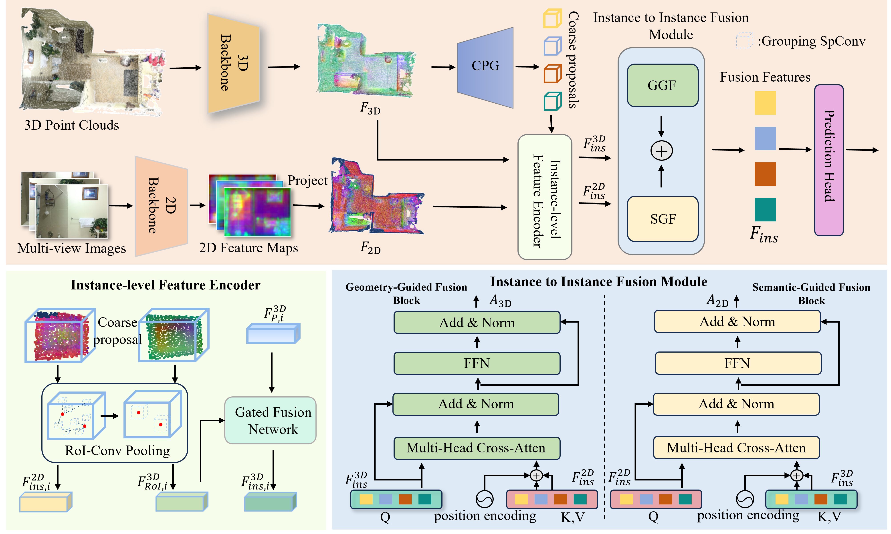

# IIFNet3D: Instance-to-Instance Fusion with Dual Attention for Indoor RGB-D 3D Object Detection
This repo contains PyTorch implementation for IIFNet3D based on [MMDetection3D](https://github.com/open-mmlab/mmdetection3d).

## Method
Overall pipeline of IIFNet3D:

## Getting Started
For environment setup:
- [Installation](docs/installation.md)

For dataset preparation:
- [Dataset preparation](docs/dataset_preparation.md)

For training and evaluation:
- [Train and Eval](docs/run.md)

## Main Results

Results are reported on the validation sets. The model weights can be
downloaded from [Baidu Drive](https://pan.baidu.com/s/1fCf4nMq__xh-XGUnQqql4A?pwd=vdte).

| Dataset | mAP@0.25 | Checkpoint | Config |
|:-------:|:--------:|:----------:|:------:|
| ScanNet V2 | **75.7** | [Baidu Drive](https://pan.baidu.com/s/1fCf4nMq__xh-XGUnQqql4A?pwd=vdte) | [config](projects/configs/IIFNet_scannet.py) |
| SUN RGB-D | **67.6** | [Baidu Drive](https://pan.baidu.com/s/1fCf4nMq__xh-XGUnQqql4A?pwd=vdte) | [config](projects/configs/IIFNet_sunrgbd.py) |

## Results
Visualization results on ScanNet:

Visualization results on SUN-RGBD:

## Acknowledgments
[mmdetection3D](https://github.com/open-mmlab/mmdetection3d)

[CAGroup3D](https://github.com/Haiyang-W/CAGroup3D)

[SPGroup3D](https://github.com/zyrant/SPGroup3D)
